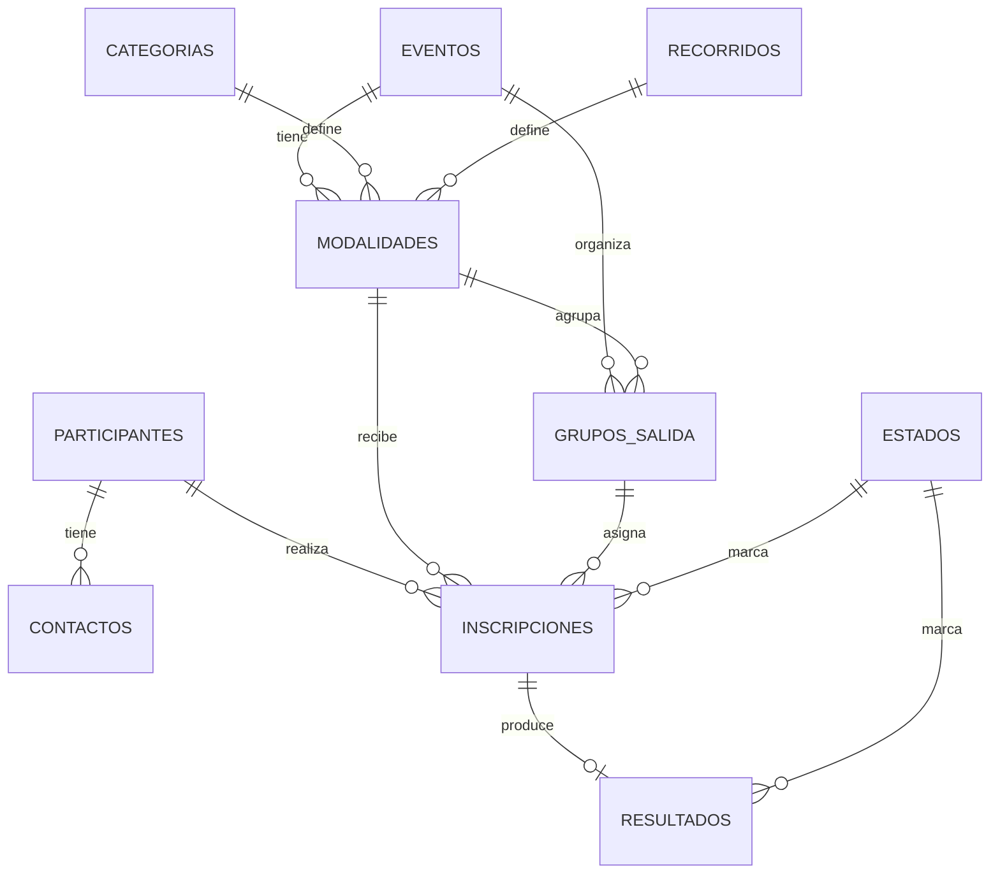

# Carrera Ciclística Uniespinal 2026

Sistema web para organizar la carrera **uniespinal2026 ciclístico**, programada para el 15 de noviembre de 2026 en El Espinal (Tolima), de 8:00 a. m. a 4:00 p. m.

Desde un solo panel se inscribe a los corredores, se les asigna una hora de salida y un color según su edad, se registran los tiempos de llegada y se publica el podio de cada modalidad.

Es un proyecto académico de la materia Bases de Datos, hecho en PHP y MySQL/MariaDB.

---

## Contenido

- [Qué problema resuelve](#qué-problema-resuelve)
- [Funciones principales](#funciones-principales)
- [Cómo se asigna la salida por edad y color](#cómo-se-asigna-la-salida-por-edad-y-color)
- [Tecnologías](#tecnologías)
- [Estructura del proyecto](#estructura-del-proyecto)
- [Base de datos](#base-de-datos)
- [Instalación paso a paso](#instalación-paso-a-paso)
- [Uso el día de la carrera](#uso-el-día-de-la-carrera)
- [Validaciones y reglas](#validaciones-y-reglas)
- [Limitaciones conocidas](#limitaciones-conocidas)
- [Autor](#autor)

---

## Qué problema resuelve

El enunciado del proyecto (archivo `Request`) pide lo siguiente:

- Inscribir participantes con cédula, nombre, dirección, teléfono y teléfono de emergencia.
- Manejar tres categorías: **Velocidad**, **Panaderas** y **Recreativas**.
- Ofrecer dos recorridos: **5 km** y **10 km**.
- Permitir que una persona se inscriba en varias categorías.
- Fijar las horas de salida según la edad, con un orden marcado por colores.
- Guardar al final el tiempo de cada competidor y su puesto en cada modalidad.

El sistema cumple esos puntos y combina cada categoría con cada recorrido. El resultado son **seis modalidades**: Velocidad 5K, Velocidad 10K, Panaderas 5K, Panaderas 10K, Recreativas 5K y Recreativas 10K.

---

## Funciones principales

| Sección del menú | Archivo | Qué permite hacer |
|---|---|---|
| **Participantes** | `index.php` | Ver a todos los inscritos con sus datos de contacto, modalidades, color y hora de salida. Buscar por cédula o nombre, ver cuántos participantes, inscripciones activas y cancelaciones hay, y cancelar o reactivar una inscripción con un clic. |
| **Nueva inscripción** | `crear_participante.php` | Registrar un corredor nuevo con sus datos personales, de contacto y de emergencia, y elegir una o varias modalidades. El grupo de salida se asigna solo. |
| **Editar participante** | `editar_participante.php` | Corregir los datos de una persona y ver o cambiar el estado de sus inscripciones. La cédula no se puede modificar. |
| **Inscribir en otra modalidad** | `inscribir_modalidad.php` | Agregar modalidades a un participante que ya existe. Las que ya tiene aparecen marcadas como "Ya inscrito" y no se pueden volver a elegir. |
| **Grupos de salida** | `grupos_salida.php` | Crear, editar y eliminar grupos, cada uno con su color, modalidad, rango de edad y hora de salida. La tabla se puede ordenar por columna y muestra cuántos inscritos tiene cada grupo. |
| **Tiempos y resultados** | `registrar_resultado.php` | Filtrar por modalidad, anotar la hora de llegada, el puesto y el estado final de cada corredor. El tiempo empleado se calcula solo. |
| **Ganadores y podio** | `ganadores.php` | Ver el podio con medallas para los tres primeros y la tabla completa de clasificación, con la opción de filtrar por modalidad. |

Archivos de apoyo:

- `db.php`: conexión a la base de datos con PDO.
- `header.php` y `footer.php`: menú, estilos y pie de página comunes a todas las pantallas.
- `cambiar_estado.php`: procesa la cancelación o reactivación de una inscripción y vuelve a la pantalla anterior.

---

## Cómo se asigna la salida por edad y color

1. El sistema calcula la edad que tendrá el corredor **el día del evento**, no la que tiene hoy.
2. Para cada modalidad elegida busca el grupo cuyo rango de edad incluya esa edad.
3. Si ningún rango coincide, asigna el primer grupo creado para esa modalidad, así la inscripción no se pierde.

Los grupos que vienen cargados en la base de datos son estos:

| Modalidad | Color | Edades | Hora de salida |
|---|---|---|---|
| Velocidad 5K | Amarillo | 14 a 29 | 8:00 |
| Velocidad 5K | Azul | 30 a 99 | 8:15 |
| Velocidad 10K | Rojo | 18 a 35 | 8:30 |
| Velocidad 10K | Negro | 36 a 99 | 8:45 |
| Panaderas 5K | Verde | 14 a 40 | 9:00 |
| Panaderas 5K | Naranja | 41 a 99 | 9:15 |
| Panaderas 10K | Blanco | 18 a 99 | 9:30 |
| Recreativas 5K | Morado | 10 a 99 | 10:00 |
| Recreativas 10K | Dorado | 16 a 99 | 10:30 |

El color no está amarrado a la edad. Cada grupo define su propio color y horario, así que el organizador puede cambiar la tabla desde **Grupos de salida** sin tocar el código.

**Ejemplo:** una persona nacida el 10 de mayo de 2000 tendrá 26 años el 15 de noviembre de 2026. Si se inscribe en Velocidad 5K y en Recreativas 10K, el sistema le asigna Amarillo (sale a las 8:00) en la primera y Dorado (sale a las 10:30) en la segunda.

---

## Tecnologías

- **PHP 7.4 o superior**, sin frameworks. Usa PDO con consultas preparadas.
- **MySQL o MariaDB**, con motor InnoDB y codificación `utf8mb4`.
- **Bootstrap 5.3** y **Bootstrap Icons**, cargados desde un CDN, por lo que se necesita internet para que la interfaz se vea con estilos.

---

## Estructura del proyecto

```
Carrera-Ciclistica/
├── Carrera.sql               # Crea la base de datos, las tablas, la vista y los datos iniciales
├── Request                   # Enunciado original del proyecto
├── db.php                    # Conexión a la base de datos
├── header.php                # Menú superior, estilos y mensajes
├── footer.php                # Pie de página y scripts
├── index.php                 # Listado de participantes
├── crear_participante.php    # Nueva inscripción
├── editar_participante.php   # Edición de datos
├── inscribir_modalidad.php   # Agregar modalidades a un participante
├── cambiar_estado.php        # Cancelar o reactivar inscripciones
├── grupos_salida.php         # Administración de grupos de salida
├── registrar_resultado.php   # Carga de tiempos y puestos
└── ganadores.php             # Podio y clasificación
```

---

## Base de datos

El script `Carrera.sql` crea la base `uniespinal_ciclismo` con diez tablas y una vista.

### Diagrama de relaciones



### Tablas

| Tabla | Para qué sirve |
|---|---|
| `eventos` | Datos del evento: nombre, fecha, hora de inicio y fin, lugar. |
| `categorias` | Velocidad, Panaderas y Recreativas. |
| `recorridos` | Circuito corto de 5 km y circuito largo de 10 km. |
| `modalidades` | Cruce de evento, categoría y recorrido. No se puede repetir la misma combinación. |
| `grupos_salida` | Color, rango de edad y hora de salida de cada grupo. Una regla impide que la edad mínima sea mayor que la máxima. |
| `participantes` | Datos personales. La cédula es única. |
| `contactos` | Teléfono del corredor, teléfono de emergencia y nombre del contacto de emergencia. |
| `estados` | Inscrito, Cancelado, Finalizado, Retirado, Descalificado y No inició. |
| `inscripciones` | Une a un participante con una modalidad y un grupo de salida. Una persona no puede inscribirse dos veces en la misma modalidad. |
| `resultados` | Hora de llegada, tiempo empleado, puestos, estado final y observaciones. Hay un solo resultado por inscripción. |

### Vista `vista_clasificacion_modalidad`

Reúne en una sola consulta el evento, la categoría, el recorrido, el nombre completo, la edad, el color y la hora de salida, la hora de llegada, el tiempo calculado, los puestos y el estado. Sirve para revisar la clasificación directamente en phpMyAdmin.

El tiempo se calcula así: **hora de llegada − hora de salida del grupo**. Si alguien sale a las 8:00 y llega a las 8:22:15, su tiempo es 00:22:15.

### Integridad de los datos

Todas las relaciones usan `ON DELETE RESTRICT`. La base no deja borrar un registro del que dependen otros. Por ejemplo, un grupo de salida con inscritos no se puede eliminar: el sistema lo revisa antes y cancela la operación.

---

## Instalación paso a paso

Estas instrucciones usan **XAMPP**, que trae Apache, PHP y MariaDB juntos. Con WAMP, Laragon o un servidor propio el proceso es casi igual.

1. **Instala XAMPP** desde [apachefriends.org](https://www.apachefriends.org/) y abre el panel de control.
2. **Enciende Apache y MySQL** con los botones *Start*.
3. **Descarga el proyecto.** Con Git:
   ```bash
   git clone https://github.com/JulianPeralta26/Carrera-Ciclistica.git
   ```
   También puedes usar el botón verde *Code → Download ZIP* de GitHub y descomprimir el archivo.
4. **Copia la carpeta** dentro de `C:\xampp\htdocs\` (en Windows), de modo que quede `C:\xampp\htdocs\Carrera-Ciclistica`.
5. **Crea la base de datos:**
   - Entra a [http://localhost/phpmyadmin](http://localhost/phpmyadmin).
   - Abre la pestaña **Importar**, elige el archivo `Carrera.sql` y pulsa **Importar**.
   - Revisa que aparezca la base `uniespinal_ciclismo` con sus diez tablas.

   > **Cuidado:** el script empieza con `DROP DATABASE IF EXISTS`. Si ya tenías una base con ese nombre, se borra con todo lo que contenga.

6. **Revisa la conexión** en `db.php`. Viene configurada para la instalación por defecto de XAMPP:
   ```php
   $host     = '127.0.0.1';
   $dbname   = 'uniespinal_ciclismo';
   $user     = 'root';
   $password = '';
   ```
   Si tu MySQL tiene otra contraseña u otro usuario, cámbialos aquí.
7. **Abre el sistema** en [http://localhost/Carrera-Ciclistica/](http://localhost/Carrera-Ciclistica/).

Si no tienes Apache, también puedes arrancarlo con el servidor que trae PHP, desde la carpeta del proyecto:

```bash
php -S localhost:8000
```

Luego entra a [http://localhost:8000](http://localhost:8000).

---

## Uso el día de la carrera

1. **Antes del evento:** revisa en **Grupos de salida** que los colores, edades y horarios sean los que quiere la organización. Ajústalos si hace falta.
2. **Inscripciones:** en **Nueva inscripción**, llena los datos y marca las modalidades. Al guardar, el sistema asigna solo el color y la hora de salida que le corresponden, y los puedes ver en **Participantes**.
3. **Cambios de última hora:** desde **Participantes** puedes editar datos, agregar modalidades o cancelar una inscripción. Cancelar no borra nada: solo cambia el estado, y se puede reactivar.
4. **Llegadas:** en **Tiempos y resultados**, elige la modalidad, escribe la hora de llegada y el puesto de cada corredor y guarda. Si alguien no termina, márcalo como Retirado, Descalificado o No inició.
5. **Premiación:** en **Ganadores y podio** aparecen los tres primeros de cada modalidad con su medalla, seguidos de la tabla completa.

---

## Validaciones y reglas

- Cédula, primer nombre, primer apellido, dirección, fecha de nacimiento, teléfono y teléfono de emergencia son obligatorios.
- No se pueden registrar dos personas con la misma cédula.
- Cada participante debe quedar inscrito al menos en una modalidad.
- Una persona no puede repetir la misma modalidad.
- En los grupos de salida, la edad mínima no puede ser mayor que la máxima.
- La inscripción del participante, su contacto y sus modalidades se guardan en una sola transacción: si algo falla, no queda nada a medias.
- Todas las consultas a la base de datos usan parámetros preparados, y los textos que se muestran en pantalla se escapan con `htmlspecialchars`.

---

## Limitaciones conocidas

Probé el sistema con PHP 8.3 y MariaDB 10.11: el script SQL importa sin errores, todas las pantallas cargan y la asignación de grupos y el cálculo de tiempos funcionan. Estos son los puntos que quedan por mejorar:

- **Los mensajes de confirmación no siempre aparecen.** Al inscribir, editar, cargar resultados o administrar grupos, el aviso verde de "guardado" no se ve después de volver a la página, aunque la operación sí queda registrada. Pasa porque esas páginas guardan el mensaje antes de iniciar la sesión de PHP, que solo se abre en `header.php`. Se arregla agregando `session_start();` justo después de `require_once 'db.php';` en esos archivos.
- **El puesto se escribe a mano.** El tiempo se calcula solo, pero el puesto en la modalidad lo digita la persona que registra las llegadas.
- **El puesto general no se calcula.** La columna `puesto_general` existe en la base de datos, pero ninguna pantalla la llena todavía.
- **Un solo evento.** Varias consultas asumen que el evento es el número 1, y la fecha del menú superior está escrita directamente en `header.php`.
- **Sin inicio de sesión.** Cualquiera que abra la dirección puede modificar datos. Para usarlo fuera de un computador local habría que agregar usuarios y contraseña.
- **Credenciales por defecto.** `db.php` usa el usuario `root` sin contraseña, que solo es aceptable en un entorno local de pruebas.

---

## Autor

**Julian Peralta Sabogal**, Uniespinal.
Proyecto de la materia Bases de Datos, 2026.
